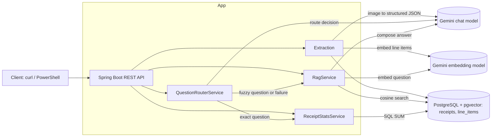

# ReceiptIQ Architecture (V1)

ReceiptIQ reads receipt images with an LLM, stores the result in PostgreSQL, and answers natural-language questions about spending. It is a Spring Boot REST API that combines relational data (exact totals) with vector search (fuzzy questions) in a single database.

This document explains how it is built and why. For setup and usage, see the [README](README.md).

## 1. Scope

**Goals**

- Extract structured data (merchant, date, line items, amounts) from receipt images.
- Store structured fields and semantic embeddings together in PostgreSQL with pgvector.
- Answer questions such as "how much did I spend at Target in August" or "what snacks did I buy" using SQL for exact questions and RAG for fuzzy ones.
- Stay backend-first. The API is exercised with curl or PowerShell, there is no UI.

**Non-goals**

- Mobile app, multi-user accounts, authentication.
- Production-grade scale, monitoring or hosted deployment.

## 2. Tech stack

| Layer | Choice | Notes |
|---|---|---|
| Language / build | Java 25, Maven | |
| Framework | Spring Boot 4.1.1, Spring AI 2.0.1 | REST API |
| Database | PostgreSQL 16 + pgvector | One database for relational and vector data, no separate vector service |
| LLM | Gemini (extraction and chat) | Model name comes from the required env var `GEMINI_API_MODEL` |
| Embeddings | `gemini-embedding-001`, 768 dimensions | Fixed in `application.yaml` on purpose (see section 6) |
| Runtime | Docker, Docker Compose | Multi-stage image, `db` and `app` services |

## 3. System overview

## 4. Data model

Two tables. The receipt is the master record, line items hang off it.

**receipts**: merchant, receipt date (nullable), total exactly as printed, `needsReview` flag.

**line_items**: receipt reference, `kind` (ITEM, TAX, TIP, FEE, DISCOUNT), description exactly as printed, `plain_eng_desc` (the model's readable expansion, null when unsure), product code, amount, category, `embedding_text`, `embedding` (vector, 768), `embedding_model` (name of the model that produced the vector).

Notes:

- Tax and tip are line items, not fields on the receipt.
- `embedding_text` is stored next to the vector so you can see why a search hit or missed.
- The schema is created by Hibernate (`ddl-auto: update`). There is no migration tool yet.

## 5. Request flows

### 5.1 Ingestion

1. A receipt image is read from the configured receipts folder (`receipts.directory`). A path-traversal guard checks the requested path against that folder.
2. The image goes to Gemini with a structured-output DTO. Extraction rules live in the DTO field descriptions.
3. The DTO is mapped to entities. A sum check compares line items to the printed total and sets `needsReview` when they disagree. It never changes a number.
4. Embeddings are created for ITEM rows only, in one batch call per receipt. Tax, tip, fee and discount rows are skipped.
5. The receipt and its line items are saved. If embedding fails, the receipt is still saved with null vectors and can be backfilled later.

Gemini calls retry with backoff on 503 and 429.

**Embedding text** = merchant + category + (`plain_eng_desc` if present, otherwise `description`). Amounts and product codes are excluded. Dates are never embedded: SQL filters dates, vectors handle meaning.

### 5.2 Question answering (RAG)

1. The question is embedded with the same model and dimension as the stored vectors.
2. A native cosine-distance query returns the top N line items (default 12, `rag.top-n`). It is top-N, not a similarity cutoff, and only rows made by the current `embedding_model` are compared.
3. Voided lines are netted in Java: a DISCOUNT row cancels one ITEM when receipt, product code and the negated amount match.
4. The retrieved rows are formatted as context lines (null dates are omitted) and sent with the question to the chat model, which writes the answer.

Vector search provides recall (candidates). The prompt provides precision. For broad questions the model is told to include every plausible item and label uncertain ones as "might be a match".

### 5.3 Smart routing

`/api/smart-ask` sends the question to a router. Gemini fills a `RouteDecision`, Java validates it, and any failure falls back to RAG. Exact questions (totals) go to SQL (`ReceiptStatsService.getTotal`), fuzzy ones go to RAG. The response is a `SmartAskResponse` record.

### 5.4 Embedding backfill

`POST /api/admin/backfill-embeddings` re-embeds line items whose `embedding_model` is null or differs from the current config value, in batches of 20. A failed batch is logged, rolled back and skipped. Running it twice is safe (the second run finds nothing to do).

## 6. Design decisions

- **The receipt is the master.** Values are stored exactly as printed. ReceiptIQ never adjusts a number, including the total.
- **Deterministic rules live in code, not prompts.** Example: `LineItemKind.defaultCategory`. Void matching is plain Java, not a model task.
- **Raw fact and model interpretation are separate fields.** `description` stays as printed, `plain_eng_desc` is the model's guess. Guesses stay distinguishable from facts.
- **One embedding per line item, not per receipt.** Search is sharper and the hit is the item itself. Merchant and category in the embedding text rescue cryptic item names.
- **Embedding model is fixed in `application.yaml`, chat model is an env var.** Vectors from different models are not comparable, even at the same dimension, and nothing errors if they are mixed. The chat model only generates text and can change without touching stored data.
- **768 dimensions.** Gemini's default of 3072 exceeds pgvector's 2000-dimension index limit.
- **Model name stored per vector.** "Needs work" is computed (model is null or differs from config), not stored as a flag. A model switch needs no reset step, and search filters by model so it stays safe mid-migration.
- **Own native cosine query**, not the Spring AI vector store advisor.
- **Totals come from SQL, not from the LLM.** Arithmetic is deterministic.
- **The LLM proposes, Java validates.** Router output is checked, and failures degrade to RAG.
- **Graceful degradation.** A receipt saves even if embedding fails.
- **Secrets at run time only.** Env vars or a git-ignored `.env`. The image and repo carry none, `.env.example` holds placeholders.
- **Docker.** Multi-stage build (Maven image, then JRE image with only the jar). The `app` service waits for the database healthcheck. It reaches Postgres by service name `db`, set through `SPRING_DATASOURCE_URL`. The shipped compose uses a named volume. The receipts folder is mounted read-only.

## 7. API endpoints

| Method | Path | Purpose |
|---|---|---|
| GET | `/receipt/getLLMReceiptJson?fileName=` | Extract one receipt image |
| GET | `/receipt/getAllReceiptsFromFolder?folderPath=` | Extract and save a folder (no duplicate check) |
| GET | `/api/ask?q=` | RAG only |
| GET | `/api/total?merchant=&from=&to=` | SQL total of `receipts.total` |
| GET | `/api/smart-ask?q=` | Router: SQL or RAG |
| POST | `/api/admin/backfill-embeddings` | Re-embed stale rows (no authentication) |

## 8. Known limits

- No duplicate check on the folder endpoint. Loading a folder twice duplicates receipts.
- The admin endpoint has no authentication. Do not expose the app publicly as is.
- Vector search is top-N, not a cutoff, so weak matches can appear. Distances sit in a tight band. Answers to broad questions (for example "snacks") vary between runs.
- The router is single pass: one question goes to SQL or RAG, never both. Multi-part questions are not handled.
- Voided lines are stored as an ITEM plus a negative DISCOUNT row and netted only at RAG time. Netting sees only the retrieved top N, and needs an exact product code match.
- Model output varies between runs. Cryptic abbreviations are expanded by guesswork and some guesses are wrong, which is why the raw text is kept. `plain_eng_desc` is sometimes null, and the embedding text falls back to `description`.
- Product code digit errors and odd spacing can occur in extraction.
- Depends on Gemini availability and quota. Retry handles 503 and 429, not long outages.
- If embedding fails, a receipt has null vectors until backfilled. Backfill is a manual call and loads all stale rows into memory at once.
- `GEMINI_API_MODEL` has no fallback, the app will not start without it. A fallback password exists in the yaml for `DB_PASSWORD`.
- Schema comes from `ddl-auto: update`, no migrations. A fresh database starts empty.
- Compose is local only. Port 5432 is published and can clash with a local Postgres. The container runs as root. No TLS, no hosted deployment.
- Cosmetic: mixed tabs and spaces in generated code, null fields in some responses.

## 9. V2 and beyond

V1 is the working core: extraction, storage, RAG, routing and Docker. Planned after V1, roughly in priority order:

**Features**

- **Receipt Assistant agent.** The model is given read-only tools (`getTotal`, `searchItems`, `listReceipts`) and chooses which to call and in what order, with a step limit. It evolves the single-pass router so multi-part questions work, for example "Did I spend more at Walmart or Target in August, and what snacks did I buy at the winner?"
- **Duplicate detection.** SHA-256 hash of the image file to skip receipts already loaded.
- **User interface and multi-platform access.** A web UI for desktop and a mobile-friendly or native app, so receipts can be captured and queried from a phone or a computer against the same data.
- **Productization.** A deployable, supportable product, with a longer-term aim of Apple App Store and Google Play distribution.

**Security and operations**

- Authentication, with roles (SuperAdmin, Admin, User). This also closes the unauthenticated admin endpoint.
- Encryption of data at rest and in transit (TLS).
- Proper logging: structured application logs and an audit trail of who did what.
- Bind or unpublish the database port.
- Flyway migrations instead of `ddl-auto`.
- Non-root container user, Actuator health endpoint, layered jar.

**Deployment**

- Free cloud deployment with hosted Postgres and pgvector.

**Smaller items**

- Default value for `GEMINI_API_MODEL`, paged backfill, optional logging of retrieved items to monitor answer quality, cleanup of formatting and null fields.

## 10. How it was built

The project idea is the author's. It was refined and built with AI assistance in three roles:

- **Author:** owns the idea, the requirements and the final decisions, and verified every change against the intended design before commit.
- **Claude (Anthropic):** technical coach. Helped sharpen the idea, explained concepts before each step, wrote the prompts for Copilot, and reviewed the results.
- **GitHub Copilot:** wrote the application code from small, single-purpose prompts.
